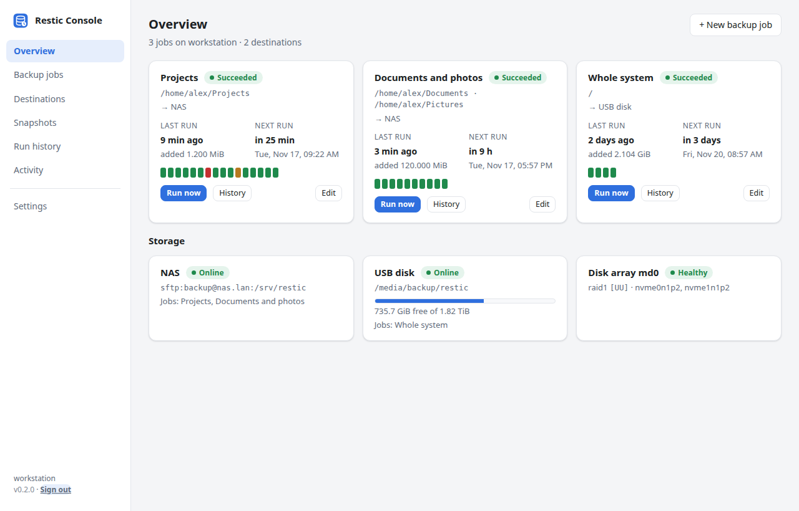
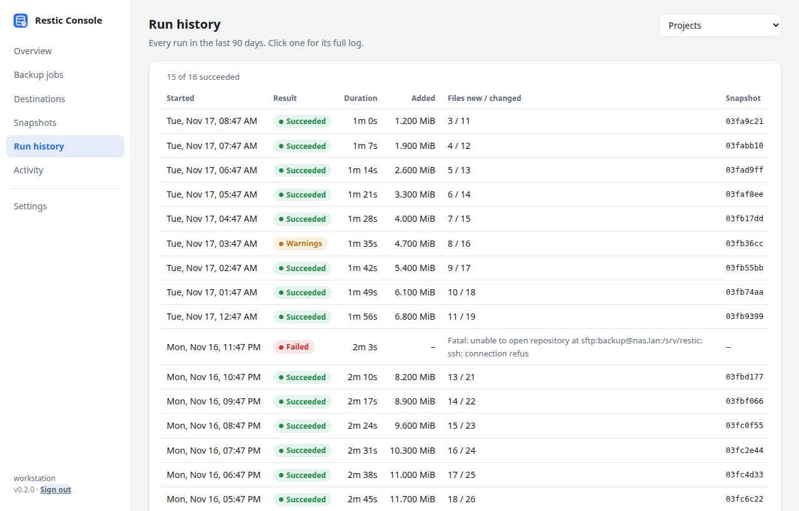
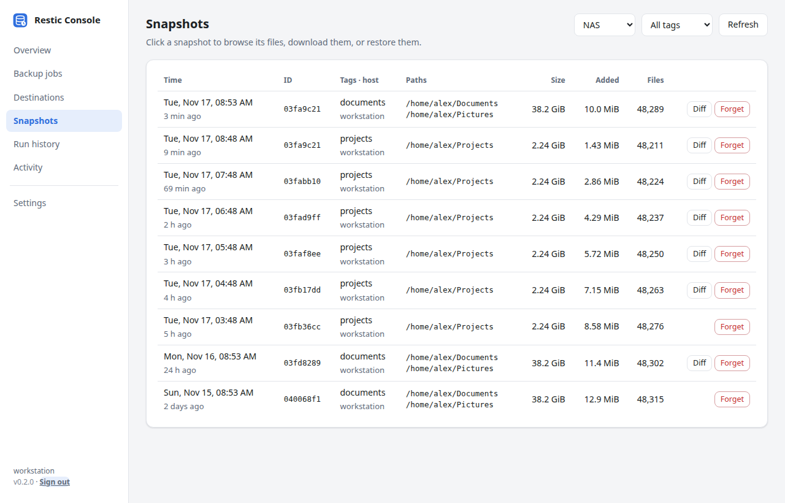

# Restic Console

[](https://github.com/king-networks/Restic-Console/actions/workflows/ci.yml)
[](LICENSE)

A small local web app for running [restic](https://restic.net) backups on **Linux and Windows**: backup jobs on a
schedule, a snapshot browser with restore and download, run history with live logs, and failure alerts by desktop
notification, email or webhook.

No dependencies beyond **restic** and **Python 3.9+** (standard library only). It runs as a background service on your
own machine, listens on `127.0.0.1` only, and opens as its own app window.

> [!IMPORTANT]
> **Disclaimer.** Restic Console is free software provided **as is, without warranty of any kind**. You use it at your
> own risk and are responsible for your own data. Test that you can restore your backups, keep your repository
> passwords somewhere safe, and keep more than one copy of anything important. The authors are not liable for lost
> data, failed backups or any other damage. See the [license](LICENSE) for the full terms.



## Features

- **Multiple jobs**, each with its own folders, destination, schedule, retention, excludes and alert rules.
  For example, the whole system weekly plus `~/Projects` every hour.
- **Multiple destinations**: local or USB disks, network shares, or any restic backend (`sftp:`, `rest:`, `s3:`, `b2:`, …).
  Create a new repository from the app, or connect an existing one.
- **Schedules** with a builder (every N minutes or hours, daily, weekly), a preview of the next run times,
  catch-up after the computer was off, and an optional random delay.
- **Snapshots**: browse any snapshot like a file manager, download files (or folders as a zip), restore into a
  new folder, compare a snapshot with the previous one, forget snapshots.
- **Run history**: every run with duration, data added and its full log, live while it runs.
- **Alerts**: desktop notification, email over SMTP, and Slack/Mattermost/Discord webhooks. Each job picks failure,
  warnings and/or success. A run that crashes or gets killed still sends a failure alert.
- **Maintenance** per destination: check (optionally re-reading a share of the data), size, prune, remove stale locks,
  retention preview.
- Storage is checked before every run, so a dead NAS never makes restic write into an empty mountpoint.
- Jobs on the same repository wait for each other's locks instead of failing.
- **Windows**: backs up open files with Volume Shadow Copy, and can log in to SMB shares with their own username and password.
- **Linux**: shows software RAID (`/proc/mdstat`) health on the overview when present.

| Run history | Snapshots |
|---|---|
|  |  |

## Install

You need restic 0.16 or newer and Python 3.9 or newer. Download the [latest release](https://github.com/king-networks/Restic-Console/releases)
(or `git clone` this repository), then:

### Linux (Ubuntu, Debian, Fedora, RHEL/Rocky/Alma, Arch, openSUSE and others with systemd)

```sh
sudo apt install restic python3          # or dnf / pacman / zypper
sudo ./linux/install.sh                  # or: sudo ./linux/install.sh --user alice
```

No recent restic in your distribution? Add `--get-restic` and the installer downloads the official release.

Log out and back in once (the installer adds you to the `restic-console` group), then open **Restic Console** from the
application menu or run `restic-console`. Details: [docs/linux.md](docs/linux.md).

### Windows 10 / 11

In an **administrator** PowerShell:

```powershell
winget install restic.restic
winget install Python.Python.3.12 --scope machine
# open a new administrator PowerShell so both are on PATH, then in the Restic Console folder:
powershell -ExecutionPolicy Bypass -File .\windows\install.ps1
```

Then open **Restic Console** from the Start menu. Details: [docs/windows.md](docs/windows.md).

### First steps

1. **Destinations → Add destination**: pick a folder or backend, and let the app create the repository.
2. **Destinations → Show password**: copy the repository password into your password manager. Without it, nobody can
   restore your backups, including you.
3. **Backup jobs → New job**: choose folders, a schedule and how many snapshots to keep. **Run now** to try it.
4. **Settings**: turn on email or webhook alerts if you want to hear about failures away from the desk.

Re-running the installer upgrades in place; your config, jobs, passwords and history are kept.

## How it works

The app is a small Python web server running as **root** (Linux) or **SYSTEM** (Windows), because it has to read
everything it backs up. Each job is run by the operating system's own scheduler (a systemd timer or a Task Scheduler
task), so backups keep running whether or not the app window is open. See [docs/how-it-works.md](docs/how-it-works.md)
for the architecture, the files it keeps, and the security model.

**Security in one paragraph:** the server listens on 127.0.0.1 only and every request needs a session obtained with a
secret token. Anyone who can read that token can make the service back up and download *any* file on the machine, so
on Linux it is readable only by root and the `restic-console` group, and on Windows by Administrators and the desktop
user you installed it for. Treat membership like admin rights. Repository passwords are kept in a root/admin-only folder.

## Limitations

- One machine per install: it backs up the computer it runs on.
- No restore-in-place: restores always go into a new folder, and you copy back what you need.
- On Windows, schedules come from the builder (every N minutes/hours, daily, weekly). Linux also accepts any
  [systemd calendar expression](https://www.freedesktop.org/software/systemd/man/latest/systemd.time.html#Calendar%20Events).
- macOS is not supported yet. The OS-specific code is all in `plat_linux.py` / `plat_windows.py`, so a `plat_macos.py`
  using launchd is the place to start. Contributions are welcome.

## Contributing

Bug reports and pull requests are welcome. See [CONTRIBUTING.md](CONTRIBUTING.md) for running it in development mode
and running the tests, and [SECURITY.md](SECURITY.md) for reporting a vulnerability privately.

## License

MIT. See [LICENSE](LICENSE). The software is provided as is, without warranty; see the [disclaimer](#restic-console)
above. Restic Console is an independent project and is not affiliated with or endorsed by the restic project.
